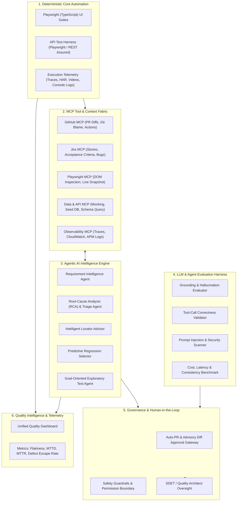

# Implementation Plan: Agentic Quality Engineering & MCP-Driven Test Automation Framework

**Reference Document:** *Beyond Selenium and Playwright: How AI, MCP, and Agentic Testing Are Redefining Quality Engineering*  
**Author / Lead Rationale:** Govinda Rao SK (Senior SDET | Quality Engineering Lead)  
**Target Milestone:** Transition from Script-Based Execution (Phase 2/3) to Intelligent, Agentic Quality Engineering (Phase 5)

---

## 1. Executive Summary & Strategic Objectives

The requirement document establishes a paradigm shift in test automation: **traditional frameworks execute strictly what they are programmed to run, but fail to uncover what engineers forgot to test or autonomously diagnose why failures occur.**

This implementation plan outlines the engineering blueprint to build an **Enterprise AI-Modernized Quality Engineering Platform**. The platform integrates deterministic test execution (**Playwright + TypeScript / Rest Assured**), open protocol tool connectivity (**Model Context Protocol - MCP**), specialized **Agentic AI workflows** (scenario design, locator repair advice, failure root-cause analysis, regression optimization), and an **LLM Application Evaluation Harness**.

### Core Guiding Principles
1. **Determinism at the Core**: Core regressions remain deterministic, repeatable, and fast. AI assists in design, triage, and optimization; it never injects stochastic uncertainty into release gating.
2. **Transparent Advisory Healing (No Silent Auto-Healing)**: AI detects locator drift and suggests accessible, resilient alternatives (e.g., role-based locators) via reviewable Pull Requests, strictly avoiding silent test mutations at runtime.
3. **Model Context Protocol (MCP) as the Context Fabric**: Standardized MCP servers connect AI agents to test artifacts, CI/CD telemetry, repository diffs, Jira specifications, and database test data.
4. **Human-in-the-Loop (HITL) Governance**: SDETs transition into **Quality Architects** who validate AI hypotheses, curate coverage, and approve automated code updates.
5. **Dual Mandate**: Build AI-augmented tools for traditional UI/API automation *and* establish evaluation harnesses for testing AI/LLM-powered software products.

---

## 2. Target Architecture Overview

---

## 3. Detailed Component Specifications

### 3.1. Deterministic Core Automation Framework
* **Primary Framework**: Playwright with TypeScript.
* **Architecture Pattern**: Page Object Model (POM) + Component Object Model + Fixture-driven state initialization.
* **Locator Strategy**: Accessible, semantic locators (`page.getByRole()`, `page.getByLabel()`, `page.getByTestId()`) prioritized over brittle XPath and CSS hierarchies.
* **Observability Package**: Mandatory collection on test failure:
  - Playwright Trace `.zip` (full DOM snapshot, timeline, action screenshots).
  - Network HAR logs with request/response timing and HTTP status codes.
  - Browser console logs and server APM trace correlation ID.

### 3.2. Model Context Protocol (MCP) Server Infrastructure
MCP provides standardized JSON-RPC communication enabling AI models to query test infrastructure without brittle ad-hoc integrations.

| MCP Server Name | Underlying Service | Key Tools Exposed | Purpose |
| :--- | :--- | :--- | :--- |
| **`mcp-github`** | GitHub API / Octokit | `get_pr_diff`, `get_commit_history`, `get_failed_workflow_logs`, `create_pull_request` | Correlate code changes with test failures; create automated locator fix PRs. |
| **`mcp-jira`** | Jira Cloud REST API | `get_issue_details`, `get_acceptance_criteria`, `query_historical_defects` | Feed requirement context to the Requirement Intelligence Agent. |
| **`mcp-playwright`** | Playwright Headless Engine | `inspect_dom_snapshot`, `evaluate_selector`, `capture_page_accessibility_tree` | Live selector analysis, DOM tree evaluation, exploratory page querying. |
| **`mcp-test-artifacts`**| S3 / Local Artifact Store | `get_test_trace_summary`, `extract_har_failures`, `get_failure_screenshot_ocr` | Unpack Playwright trace `.zip` files and feed timeline events to the RCA Agent. |
| **`mcp-testdata-db`** | PostgreSQL / Test Data API | `query_test_account`, `seed_member_record`, `reset_test_state` | Dynamic test data verification and provisioning for BFSI/Healthcare scenarios. |

### 3.3. Pluggable LLM Provider Abstraction
To support flexible, enterprise-grade deployment:
- **Default Provider**: Local **Ollama** (`http://127.0.0.1:11434`, utilizing local models such as `qwen2.5:latest` or `llama3.2:latest`) for privacy-preserving, zero-cloud-cost execution.
- **Cloud Providers**: Pluggable interfaces for **OpenAI** (`gpt-4o`), **Anthropic** (`claude-3-5-sonnet`), and **Google Gemini** (`gemini-1.5-pro` / `gemini-2.0-flash`).
- **Configuration Switch**: Dynamic selection via environment variable `LLM_PROVIDER=ollama` | `openai` | `gemini` | `anthropic`.

---

## 4. Implementation Milestones

- **Sprint 0 / Foundation**: Playwright + TypeScript setup, GitHub Actions workflow, Pluggable LLM provider (Ollama default), custom Test Artifacts MCP server, and automated Failure RCA engine.
- **Sprint 1 (Weeks 1-4)**: Resilient POM suites, HAR & trace recording, baseline flakiness elimination.
- **Sprint 2 (Weeks 5-8)**: Full MCP server mesh (`mcp-github`, `mcp-jira`, `mcp-playwright`).
- **Sprint 3 (Weeks 9-13)**: Requirement scenario generator and Advisory Locator repair pull request bot.
- **Sprint 4 (Weeks 14-17)**: Predictive regression test selection linked to git diffs.
- **Sprint 5 (Weeks 18-22)**: LLM application evaluation harness (tool-call correctness, hallucination, prompt injection).
- **Sprint 6 (Weeks 23-26)**: Unified Quality Dashboard and SDET team enablement.
