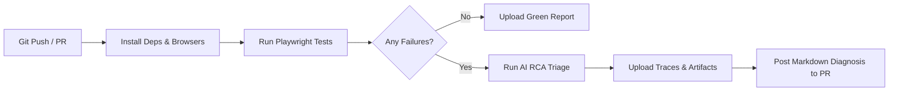

# Agentic Quality Engineering Platform — User Guide

Welcome to the **Agentic Quality Engineering Platform** user guide. This platform bridges deterministic test execution (**Playwright + TypeScript**), standardized tool connectivity (**Model Context Protocol - MCP**), and local/cloud **AI Intelligence (Ollama, OpenAI, Gemini)** to modernize quality engineering and automate failure triage.

---

## Table of Contents
1. [System Prerequisites & Installation](#1-system-prerequisites--installation)
2. [Configuring LLM Providers (Pluggable Abstraction)](#2-configuring-llm-providers-pluggable-abstraction)
3. [Writing Resilient Automation Tests](#3-writing-resilient-automation-tests)
4. [Running Tests & Automated Failure RCA](#4-running-tests--automated-failure-rca)
5. [Using the Model Context Protocol (MCP) Server](#5-using-the-model-context-protocol-mcp-server)
6. [CI/CD Execution with GitHub Actions](#6-cicd-execution-with-github-actions)
7. [Interpreting AI Root-Cause Diagnostic Reports](#7-interpreting-ai-root-cause-diagnostic-reports)
8. [Troubleshooting & Frequently Asked Questions (FAQ)](#8-troubleshooting--frequently-asked-questions-faq)

---

## 1. System Prerequisites & Installation

### 1.1 Prerequisites
- **Node.js**: v20.x or v22.x+ ([Download Node.js](https://nodejs.org))
- **npm**: v10.x+
- **Git**: Installed and configured
- **Ollama**: For local, zero-cost AI triage ([Download Ollama](https://ollama.ai))

### 1.2 Installation Steps
```bash
# 1. Clone repository
git clone https://github.com/goviselenium/AIEngineering.git
cd AIEngineering

# 2. Install Node dependencies
npm install

# 3. Install Playwright browser binaries
npx playwright install chromium

# 4. Pull local Ollama model for triage
ollama pull llama3.2:latest
# Or: ollama pull qwen2.5:latest
```

---

## 2. Configuring LLM Providers (Pluggable Abstraction)

The platform features a **Pluggable Provider Architecture** allowing you to switch between local and cloud AI providers without changing application code.

Create or edit your local `.env` file (copied from `.env.example`):

### Option A: Local Ollama (Default, Zero-Cost & Private)
```env
LLM_PROVIDER=ollama
OLLAMA_BASE_URL=http://127.0.0.1:11434
OLLAMA_MODEL=llama3.2:latest
```
> **Recommendation**: `llama3.2:latest` (2.0 GB) is optimal for high-speed CPU inference. For deeper reasoning on multi-layered failures, use `qwen2.5:latest` or `deepseek-r1:8b`.

### Option B: OpenAI / OpenAI-Compatible (vLLM, Azure OpenAI)
```env
LLM_PROVIDER=openai
OPENAI_API_KEY=sk-proj-your-api-key
OPENAI_BASE_URL=https://api.openai.com/v1
OPENAI_MODEL=gpt-4o
```

### Option C: Google Gemini
```env
LLM_PROVIDER=gemini
GEMINI_API_KEY=your-gemini-api-key
GEMINI_MODEL=gemini-2.0-flash
```

---

## 3. Writing Resilient Automation Tests

To avoid brittle tests and high maintenance overhead, follow the **Semantic Role-Based Locator Pattern** implemented in `src/core/base-page.ts`.

### 3.1 Locator Best Practices
| DO USE (Semantic & Accessible) | AVOID (Brittle & Positional) |
| :--- | :--- |
| `page.getByRole('button', { name: 'Submit' })` | `page.locator('//form/div[3]/button[1]')` |
| `page.getByLabel('Contract Title')` | `page.locator('#input_23984')` |
| `page.getByTestId('eligibility-badge')` | `page.locator('.css-1823-badge')` |

### 3.2 Creating a Page Object
Extend `BasePage` to inherit resilient waiting and action wrappers:

```typescript
import { Page, Locator } from '@playwright/test';
import { BasePage } from '../core/base-page.js';

export class MemberPortalPage extends BasePage {
  readonly searchInput: Locator;
  readonly searchButton: Locator;
  readonly resultsList: Locator;

  constructor(page: Page) {
    super(page);
    this.searchInput = this.getByRole('textbox', { name: 'Search Member' });
    this.searchButton = this.getByRole('button', { name: 'Search' });
    this.resultsList = this.getByRole('list', { name: 'Results' });
  }

  async searchMember(query: string): Promise<void> {
    await this.safeFill(this.searchInput, query, 'Member Search Input');
    await this.safeClick(this.searchButton, 'Search Button');
  }
}
```

### 3.3 Authoring Tests with Telemetry Capture
Always import `test` and `expect` from `../../src/core/fixtures.js` so that console errors and network delays are automatically recorded into the telemetry log upon failure:

```typescript
import { test, expect } from '../../src/core/fixtures.js';
import { MemberPortalPage } from '../../src/pages/member-portal-page.js';

test.describe('Member Search Flow', () => {
  test('should find active member by ID', async ({ page }) => {
    const portal = new MemberPortalPage(page);
    await portal.goto('/members');
    await portal.searchMember('MEM-98721');

    await expect(portal.resultsList).toBeVisible();
  });
});
```

---

## 4. Running Tests & Automated Failure RCA

### 4.1 CLI Execution Commands

| Task | Command | Description |
| :--- | :--- | :--- |
| **Run All Tests** | `npm test` | Runs all Playwright tests headlessly. |
| **Headed Mode** | `npm run test:headed` | Opens a visible browser window for interactive debugging. |
| **Playwright UI Mode** | `npm run test:ui` | Launches Playwright's time-travel UI inspector. |
| **Continuous Triage** | `npm run test:triage` | Executes test suite and immediately runs AI RCA triage on any failures. |
| **Standalone AI RCA** | `npm run rca` | Analyzes existing `test-results/results.json` and outputs root-cause reports. |

### 4.2 What Happens When a Test Fails?
1. Playwright captures full telemetry:
   - DOM snapshot & action timeline: `test-results/.../trace.zip`
   - Failure screenshot: `test-results/.../test-failed-1.png`
   - Network failure logs: `test-results/.../telemetry-log.json`
2. The **Failure RCA Engine** (`scripts/run-rca.ts`):
   - Extracts failed locators and error messages.
   - Correlates network 4xx/5xx responses and console exceptions.
   - Invokes the configured LLM (Ollama default).
   - Generates:
     - `test-results/rca-summary.md` (Markdown summary for GitHub PRs).
     - `test-results/rca-summary.json` (Structured JSON manifest).

---

## 5. Using the Model Context Protocol (MCP) Server

The platform includes a native **Model Context Protocol (MCP)** server (`src/mcp/servers/test-artifacts-mcp.ts`) that enables AI assistants (such as Antigravity, Claude Desktop, or Cursor) to directly query test results, telemetry, and locators.

### 5.1 Starting the MCP Server Locally
```bash
npm run mcp:server
```
The server runs over standard I/O (`stdio`) using JSON-RPC 2.0.

### 5.2 Connecting MCP to Claude Desktop or Antigravity
Add the following to your MCP client configuration (e.g., `claude_desktop_config.json`):

```json
{
  "mcpServers": {
    "test-artifacts": {
      "command": "npx",
      "args": ["tsx", "E:/AI_PORTABLE/PROJECTS/AIEngineering/scripts/start-mcp-server.ts"]
    }
  }
}
```

### 5.3 Available MCP Tools

#### 1. `get_failed_tests_summary`
- **Description**: Returns all failing and timed-out tests from the latest run.
- **Example Assistant Query**: *"What tests failed in the latest regression run?"*

#### 2. `get_test_telemetry`
- **Parameters**: `{ "testTitle": "string" }`
- **Description**: Retrieves full network errors, console exceptions, and stack traces for a specific test.
- **Example Assistant Query**: *"Show me the network errors and stack trace for 'should triage delayed API response'"*

#### 3. `recommend_resilient_locator`
- **Parameters**: `{ "fragileSelector": "string", "elementRole": "string", "accessibleName": "string" }`
- **Description**: Converts a brittle XPath or CSS selector into a semantic Playwright locator.
- **Example Assistant Query**: *"Convert `//div[3]/form/button[2]` with text 'Save Contract' into an accessible locator"*
- **Response**: `await page.getByRole('button', { name: 'Save Contract' })`

---

## 6. CI/CD Execution with GitHub Actions

The platform includes a production-ready GitHub Actions workflow in `.github/workflows/test-and-triage.yml`.

### 6.1 Workflow Lifecycle


### 6.2 Required GitHub Secrets (Optional)
If using cloud providers in CI instead of Ollama, configure repository secrets under **Settings > Secrets and variables > Actions**:
- `OPENAI_API_KEY` (if using OpenAI)
- `GEMINI_API_KEY` (if using Google Gemini)
- `GITHUB_TOKEN` (automatically provided by GitHub Actions for commenting on PRs)

---

## 7. Interpreting AI Root-Cause Diagnostic Reports

The RCA engine categorizes every failure into one of five standard engineering classifications:

```
+--------------------------------------------------------------------------------+
| AI Root Cause Classifications                                                 |
+--------------------------------------------------------------------------------+
| 🚨 APPLICATION_DEFECT      | The application broke business logic or crashed.  |
| ⚠️ LOCATOR_DRIFT           | UI DOM or accessibility attribute changed.        |
| 🌐 API_DELAY_OR_ENVIRONMENT| 504 Gateway Timeout or slow backend dependency.   |
| 🗄️ TEST_DATA_MISMATCH      | Seed data expired or user record missing.         |
| ⏱️ SYNCHRONIZATION_FLAKE   | Race condition; animation or rendering delay.     |
+--------------------------------------------------------------------------------+
```

### Sample Output in `test-results/rca-summary.md`
```markdown
## 🤖 AI-Powered Failure Analysis & Root Cause Triage
> **Run Summary:** 1 failed test(s) triaged using OLLAMA provider.

| Status | Test Title | Failure Category | Confidence | Recommended Action |
| :--- | :--- | :--- | :---: | :--- |
| ❌ | **should triage delayed API response** | 🚨 **Application Defect** | 90% | Verify API latency and element visibility within timeout. |

#### 1. Detailed Diagnostic
- **Classification**: `APPLICATION_DEFECT`
- **Evidence**:
  - `locator.toBeVisible() timed out after 2000ms`
  - `telemetry-log captured HTTP 504 on /api/v1/members/eligibility-filters`
- **Suggested Fix**:
  ```typescript
  // Increase timeout or verify upstream service health:
  await page.waitForResponse(resp => resp.url().includes('eligibility-filters') && resp.status() === 200);
  ```
```

---

## 8. Troubleshooting & Frequently Asked Questions (FAQ)

### Q1: Ollama error: `fetch failed` or `ECONNREFUSED 127.0.0.1:11434`
- **Cause**: Ollama service is not running locally.
- **Solution**: Open a terminal and run `ollama serve`. Verify with `curl http://127.0.0.1:11434/api/tags`.

### Q2: Ollama inference times out during RCA triage
- **Cause**: The loaded model is too large for CPU inference.
- **Solution**: Switch to `llama3.2:latest` in `.env` (`OLLAMA_MODEL=llama3.2:latest`). It evaluates in under 15 seconds.

### Q3: How do I inspect the Playwright Trace `.zip` file?
- Run Playwright's trace viewer CLI:
  ```bash
  npx playwright show-trace test-results/<folder-name>/trace.zip
  ```

### Q4: Does AI self-healing modify test code automatically?
- **No.** Following the core principle: **"Autonomy without validation is not quality engineering."** AI produces structured advisory diffs and suggested code fixes for human SDET review; it never silently mutates test code during live execution.
