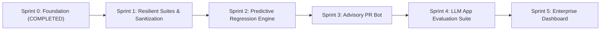

# Project Understanding & Architectural Consultation Document

**Project Name:** Agentic Quality Engineering & MCP-Driven Automation Platform (`AIEngineering`)  
**Lead Architect / Role:** Project Consultant, Technical Project Manager, System Architect & Lead Developer  
**Baseline Reference:** *Beyond Selenium and Playwright: How AI, MCP, and Agentic Testing Are Redefining Quality Engineering* by Chanchal T.  
**Repository:** [https://github.com/goviselenium/AIEngineering](https://github.com/goviselenium/AIEngineering)  
**Date:** October 14, 2026  

---

## 1. Project Overview & Core Vision

- **Project Name:** Agentic Quality Engineering & MCP-Driven Automation Platform (`AIEngineering`)
- **One-Sentence Pitch:** An enterprise-grade quality engineering platform that fuses deterministic Playwright automation with Model Context Protocol (MCP) and pluggable local/cloud LLMs (Ollama default) to automate failure root-cause analysis, recommend resilient locators, and evaluate AI-driven enterprise applications.
- **Primary Problem Solved:** 
  1. **Manual Triage Bottlenecks:** When automated tests fail in CI/CD, engineers spend 30–60 minutes per incident inspecting raw logs, DOM traces, and network payloads to determine if a failure is an application bug, an environment delay, or a flaky selector.
  2. **High Locator Maintenance Costs:** Minor frontend DOM refactors frequently break brittle XPath and CSS selectors, generating noise and maintenance fatigue.
  3. **The Coverage Blindspot:** Traditional automation only checks what it is explicitly scripted to check; it does not identify forgotten edge cases, race conditions, or partial API failure states.
  4. **The AI Testing Gap:** Conventional test frameworks cannot evaluate stochastic AI agent behaviors (tool-call correctness, hallucination, prompt injection, RAG grounding).

---

## 2. Target Audience & Stakeholders

- **End Users:**
  - **Senior SDETs & Quality Engineers:** Authors and maintainers of UI/API test suites who benefit from automated failure root-cause classification and resilient locator recommendations.
  - **Software Developers:** Engineers receiving rapid, context-rich PR failure diagnostics with exact timestamps, network error codes, and remediation steps.
  - **QA Leads & Quality Architects:** Leaders overseeing test suite stability, flakiness indices, and release risk gating.
- **Key Stakeholders:**
  - **Engineering Directors / VP of Engineering:** Requiring reduced regression cycle times, lower cloud CI compute costs, and zero defect escapes.
  - **Release Managers & Product Owners:** Needing transparent release health scorecards before deploying to production.
  - **Security & Compliance Officers (Healthcare / BFSI):** Demanding strict data confidentiality (zero leakage of PHI/PII to cloud LLMs) and verifiable audit trails.

---

## 3. Technical Stack & Environment

- **Core Automation Engine:** Playwright (TypeScript) v1.49+
- **Runtimes & SDKs:** Node.js v20.x / v24.x, TypeScript v5.7+ (NodeNext ESM), Python 3.13 (optional AI utilities)
- **Tool Connectivity Standard:** Model Context Protocol (MCP) via `@modelcontextprotocol/sdk` (JSON-RPC over stdio)
- **AI & LLM Inference Layer:** Pluggable Provider Abstraction
  - **Default Local Provider:** **Ollama** (`http://127.0.0.1:11434`), optimized for `llama3.2:latest` (2.0 GB) and `qwen2.5:latest` (5.1 GB)
  - **Cloud Providers:** OpenAI (`gpt-4o`), Google Gemini (`gemini-2.0-flash`), Anthropic (`claude-3-5-sonnet`)
- **CI/CD Orchestration:** GitHub Actions (`.github/workflows/test-and-triage.yml`)
- **Observability & Artifact Storage:** Playwright Traces (`.zip`), Network HAR logs, failure screenshots, console logs, and Markdown/JSON triage manifests

---

## 4. Core Features & Functional Requirements

1. **Deterministic Automation Core with Semantic Locators:**
   - Base Page Object Model ([`BasePage`](file:///e:/AI_PORTABLE/PROJECTS/AIEngineering/src/core/base-page.ts)) strictly enforcing W3C ARIA accessible role locators (`getByRole()`, `getByLabel()`, `getByTestId()`).
   - Custom fixtures capturing network failures (4xx/5xx) and console logs into structured `telemetry-log.json`.

2. **Automated AI Failure Root-Cause Analysis (RCA) Engine:**
   - Multi-modal triage pipeline ([`failure-analyzer.ts`](file:///e:/AI_PORTABLE/PROJECTS/AIEngineering/src/ai/rca/failure-analyzer.ts)) correlating Playwright execution errors, call logs, network latency, and DOM snapshots.
   - Categorizes failures into 5 standard engineering classifications:
     - 🚨 `APPLICATION_DEFECT`
     - ⚠️ `LOCATOR_DRIFT`
     - 🌐 `API_DELAY_OR_ENVIRONMENT`
     - 🗄️ `TEST_DATA_MISMATCH`
     - ⏱️ `SYNCHRONIZATION_FLAKE`
   - Generates confidence scores, evidence chains, and suggested code fixes.

3. **Model Context Protocol (MCP) Tool Server:**
   - Standardized MCP server ([`test-artifacts-mcp.ts`](file:///e:/AI_PORTABLE/PROJECTS/AIEngineering/src/mcp/servers/test-artifacts-mcp.ts)) exposing tools over stdio:
     - `get_failed_tests_summary`: Lists all failures from latest run.
     - `get_test_telemetry`: Extracts logs, network errors, and stack traces for a specific test.
     - `recommend_resilient_locator`: Converts brittle XPath/CSS into semantic accessible role locators.

4. **Pluggable LLM Provider Fabric:**
   - Clean interface and factory ([`base-provider.ts`](file:///e:/AI_PORTABLE/PROJECTS/AIEngineering/src/ai/providers/base-provider.ts)) allowing zero-cost local Ollama inference by default or instant switching to OpenAI / Gemini via environment variable (`LLM_PROVIDER=ollama`).

5. **CI/CD Continuous Triage Pipeline:**
   - GitHub Actions workflow that executes tests, spins up Ollama in CI, captures telemetry, and automatically posts markdown triage reports to Pull Requests.

6. **AI Agent & LLM Application Evaluation Framework (Section 3E Roadmap):**
   - Specialized evaluation harnesses to test AI products: RAG hallucination checks, tool-call accuracy, prompt-injection defense, and latency/cost benchmarking.

---

## 5. Non-Functional Requirements

- **Performance & Latency:**
  - Local AI triage latency target: < 20 seconds per failure using `llama3.2:latest`.
  - CI PR test feedback loop: < 8 minutes for targeted test suites.
- **Security, Privacy & Compliance (HIPAA / BFSI):**
  - **Privacy-First:** Default local Ollama inference ensures zero test payloads or enterprise data leave the internal network.
  - **Sanitization:** Automated PII/PHI redaction on traces before feeding to LLM prompts.
  - **Least Privilege:** MCP servers operate with read-only scopes.
- **Governance & Determinism (No Silent Self-Healing):**
  - The framework **strictly forbids silent runtime test mutations**. Self-healing recommendations are formatted as reviewable advisory diffs and Pull Requests requiring SDET sign-off.
- **Scalability:**
  - Parallel matrix execution across CI runners; modular MCP micro-servers capable of independently scaling.

---

## 6. Current Status & Roadmap

- **Current Stage:** **MVP & Functional Foundation Completed (Sprint 0)**
  - Core Playwright TypeScript framework established.
  - Pluggable LLM abstraction fully operational with local Ollama (`llama3.2` / `qwen2.5`).
  - Automated Failure RCA Engine implemented and verified against real failure telemetry.
  - Test Artifacts MCP Server implemented and registered.
  - GitHub Actions workflow written and tested.
  - Codebase tracked and pushed to [GitHub](https://github.com/goviselenium/AIEngineering).
- **Immediate Next Milestone (Sprint 1 & 2):**
  - Build the **Automated Advisory PR Generator** (creating GitHub Pull Requests with locator patches).
  - Implement **Predictive Regression Selection** (mapping git diffs to test dependency trees).
  - Build the **LLM Evaluation Harness** (tool-calling and RAG grounding verification).

---

## Consultant Analysis & Instructions Fulfillment

### Part 1: Confirmation & Understanding of Project Purpose
The **Agentic Quality Engineering Platform** is not another script generator or Selenium wrapper. It represents an evolution into **Phase 5 Quality Engineering**:
1. It acknowledges that deterministic test suites (Playwright) remain the foundation of release verification, but injects **Agentic AI** and **Model Context Protocol (MCP)** at the friction points: failure triage, locator resilience, coverage expansion, and regression selection.
2. It prioritizes **data sovereignty and cost efficiency** by placing local Ollama models (`llama3.2`) at the center of the architecture, while retaining a pluggable adapter for enterprise cloud models (OpenAI, Gemini).
3. It firmly upholds the principle that **"Autonomy without validation is not quality engineering"**—AI advises and investigates, but humans approve code changes and verify business correctness.

---

### Part 2: Gap, Risk & Bottleneck Analysis

| Area | Potential Gap / Risk | Impact | Architectural Mitigation |
| :--- | :--- | :--- | :--- |
| **1. LLM Latency in CI/CD** | Running large 7B+ LLMs on CPU-only GitHub Actions runners can cause timeouts or high runner minutes. | High | In CI/CD, use lightweight models (`llama3.2:1b`, `qwen2.5:0.5b`) or configure an API key for fast cloud fallback (`gemini-2.0-flash` / `gpt-4o-mini`). In local dev, use Ollama GPU acceleration. |
| **2. PII / Sensitive Data Leakage** | Healthcare and BFSI test traces may capture real or semi-realistic member records, SSNs, or tokens. | Critical | Implement an automated regex and NER sanitization layer in `TraceParser` that scrubs email addresses, SSNs, credit cards, and JWT tokens before LLM prompt construction. |
| **3. Flaky Trace Zip Unpacking** | If Playwright crashes abruptly (e.g., node OOM), `trace.zip` might be corrupted or half-written. | Medium | Add resilient try-catch fallbacks in `TraceParser` so that if `trace.zip` fails to unpack, triage gracefully falls back to `results.json`, console logs, and screenshots. |
| **4. Regression Selection Accuracy** | Naive change-impact analysis might skip an indirectly coupled test and cause a defect escape. | High | Enforce a dual-tier strategy: run smart targeted test subsets on PR builds, but enforce full comprehensive regression suites on nightly and pre-release pipelines. |
| **5. Context Window Saturation** | Tests with verbose console spam or massive DOM trees can overflow the LLM's context window. | Medium | Enforce strict slicing (e.g. max 500 chars per error, max 10 failed network requests) and strip ANSI terminal escape sequences (already implemented). |

---

### Part 3: Phased Implementation Action Plan

#### Phase 1: Test Data Sanitization & Suite Expansion (Weeks 1 – 2)
- [x] Modern Playwright TypeScript setup with BasePage and fixtures.
- [x] Pluggable LLM Provider (Ollama default) and Failure RCA engine.
- [ ] Implement `DataSanitizer` utility to scrub PII/PHI and bearer tokens from telemetry logs.
- [ ] Expand Healthcare Member Portal and BFSI Contract page objects with complete user flows.

#### Phase 2: Predictive Regression Selection (Weeks 3 – 5)
- [ ] Build Git Diff analyzer linking changed files to Page Objects and test tags (`@contracts`, `@billing`, `@auth`).
- [ ] Configure GitHub Actions to execute targeted test slices on PRs (< 5 min feedback) and full regressions nightly.

#### Phase 3: Automated Advisory Locator PR Bot (Weeks 6 – 8)
- [ ] Connect `mcp-github` to generate automated GitHub Pull Requests when locator drift is diagnosed.
- [ ] Include before/after screenshots and confidence scores in the PR description for SDET review.

#### Phase 4: AI Agent & LLM Application Evaluation Harness (Weeks 9 – 12)
- [ ] Build evaluation runners for product AI features (evaluating customer-facing LLM agents).
- [ ] Implement deterministic schema checks, tool-call accuracy scores, and RAG hallucination metrics (Context Relevance & Groundedness).
- [ ] Add automated prompt-injection and security fuzzing test cases.

#### Phase 5: Unified Quality Dashboard & Team Enablement (Weeks 13 – 16)
- [ ] Deploy web-based Quality Dashboard tracking MTTD, MTTR, flake rate trends, and locator maintenance hours saved.
- [ ] Conduct SDET upskilling workshops on MCP tool creation and AI-assisted quality engineering.
