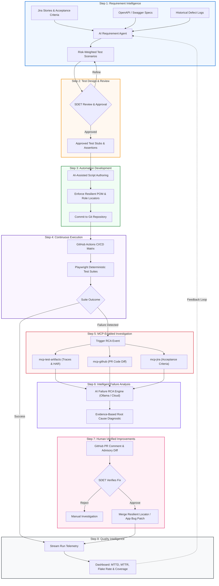
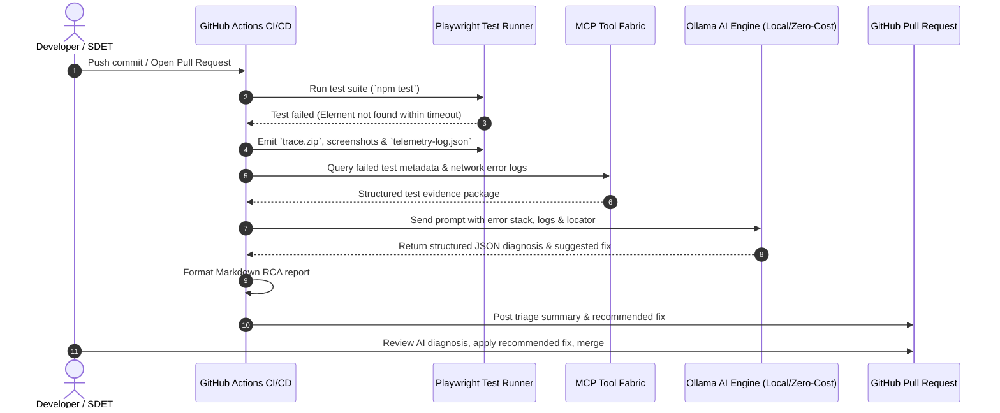

# Modernized Quality Engineering Workflow Specification

**Reference Document:** *Beyond Selenium and Playwright: How AI, MCP, and Agentic Testing Are Redefining Quality Engineering*  
**Operational Standard:** Phase 5 Agentic Quality Engineering Lifecycle

---

## 1. Overview & Operational Philosophy

Traditional test automation operates strictly linearly: **code is written, tests execute, and failures are triaged manually**. When locators break or synchronization lags, test engineers spend hours combing through logs, screenshots, and DOM states.

The **Modernized Quality Engineering Workflow** transforms this dynamic into an intelligent, closed-loop ecosystem. Artificial Intelligence (AI) assists in requirement discovery, locator maintenance, and root-cause analysis; Model Context Protocol (MCP) provides a standardized context fabric; while the **Software Development Engineer in Test (SDET)** retains ultimate authority over business correctness and release confidence.

> **Foundational Principle:**  
> *"AI should help engineers understand and resolve failures, not automatically hide them. Autonomy without validation is not quality engineering."*

---

## 2. End-to-End Workflow Diagram



---

## 3. The 8-Step Lifecycle Detailed Breakdown

### Step 1 — Requirement Intelligence
- **Objective**: Identify test coverage gaps, edge cases, and non-functional requirements early in the sprint.
- **Inputs**: User Stories, Acceptance Criteria (Jira), OpenAPI schemas, past defect logs.
- **Process**:
  - AI parses the functional specifications and generates orthogonal test matrices.
  - Generates cross-functional scenarios: role-based authorization checks, boundary inputs, distributed service latency, partial API failure modes, and concurrency risks.
- **Output**: Structured Scenario Matrix formatted in Gherkin or JSON.

### Step 2 — Test Design and Review (Human-in-the-Loop)
- **Objective**: Ensure that generated coverage is meaningful, accurate, and aligned with domain regulations (e.g., HIPAA, PCI-DSS).
- **Owner**: Senior SDET / Quality Architect.
- **Process**:
  - SDET reviews proposed scenarios against actual business rules.
  - Defines precise deterministic assertions and test data constraints.
- **Output**: Signed-off test specifications ready for scripting.

### Step 3 — Automation Development
- **Objective**: Build robust, maintainable UI and API automation scripts.
- **Standards Enforced**:
  - Semantic Accessible Locators (`getByRole`, `getByLabel`, `getByTestId`).
  - Strict prohibition of brittle positional XPath (`//div[2]/table/tr[3]/td[1]`).
  - Zero arbitrary sleeps (`page.waitForTimeout` is blocked); reliance on Playwright's automatic waiting and `waitForResponse`.
- **Output**: Modular Page Object Model files and `.spec.ts` test suites.

### Step 4 — Continuous Execution
- **Objective**: Run deterministic validation repeatedly across pull requests and nightly builds.
- **Orchestration**: GitHub Actions matrix workflow (`.github/workflows/test-and-triage.yml`).
- **Telemetry Emitted**:
  - Full execution timeline and DOM snapshots: `trace.zip`.
  - Network logs and request/response timings: `telemetry-log.json` / HAR.
  - Video recordings and screenshots on test failure.
  - Machine-readable test results: `test-results/results.json`.

### Step 5 — MCP-Enabled Investigation
- **Objective**: Connect AI agents to testing tools, CI/CD logs, and repositories using open protocols.
- **Context Mesh (Model Context Protocol)**:
  - `mcp-test-artifacts`: Queries Playwright trace files, network failure codes, and DOM snapshots.
  - `mcp-github`: Inspects PR commit diffs and recent code changes.
  - `mcp-jira`: Fetches relevant user stories and historical bug patterns.
- **Output**: Consolidated, normalized evidence package.

### Step 6 — Intelligent Failure Analysis (AI Root-Cause Triage)
- **Objective**: Automatically diagnose the exact root cause of test failures without requiring human manual log parsing.
- **Decision Engine**:
  ```mermaid
  flowchart TD
      Start["Test Failure Ingested"] --> NetCheck{"Network Telemetry Error (4xx / 5xx)?"}
      NetCheck -- Yes --> C1["Classification: API_DELAY_OR_ENVIRONMENT"]
      NetCheck -- No --> LocCheck{"Element Locator Timeout?"}
      LocCheck -- Yes --> DOMCheck{"Element in DOM with different role/name?"}
      DOMCheck -- Yes --> C2["Classification: LOCATOR_DRIFT"]
      DOMCheck -- No --> C3["Classification: SYNCHRONIZATION_FLAKE or DEFECT"]
      LocCheck -- No --> AssertCheck{"Assertion Value Mismatch?"}
      AssertCheck -- Yes --> C4["Classification: APPLICATION_DEFECT"]
      AssertCheck -- No --> C5["Classification: TEST_DATA_MISMATCH"]
  ```
- **Inference**: Provided by local **Ollama** (`llama3.2:latest` / `qwen2.5:latest`) or pluggable cloud models.
- **Output**: Diagnostic reports (`rca-summary.md` and `rca-summary.json`).

### Step 7 — Human-Verified Improvements (Advisory Diffs)
- **Objective**: Resolve locator drift and flaky synchronization with human validation.
- **Policy**: **No Silent Runtime Self-Healing.**
  - If locator drift is detected, the AI generates a proposed code patch (Advisory Diff) and posts it to the PR.
  - The SDET reviews the change, confirms the original intent has not been corrupted, and approves the PR.
- **Output**: Verified code updates merged into the codebase.

### Step 8 — Quality Intelligence & Metrics
- **Objective**: Track overall health, trend analysis, and engineering productivity metrics.
- **Key Metrics Tracked**:
  - **Mean Time to Triage (MTTT)**: Target < 10 minutes.
  - **Flakiness Index**: Target < 2% across regression suites.
  - **Automation Maintenance Savings**: > 60% reduction in locator debugging hours.
  - **Defect Escape Rate**: Zero production defect escapes from targeted test slices.
- **Feedback Loop**: Historical stability metrics are fed back into Step 1 to optimize test scenario weighting.

---

## 4. Responsibility Assignment Matrix (RACI)

| Workflow Step | SDET / Quality Lead | AI Agent / MCP | Software Developer | Engineering Manager |
| :--- | :---: | :---: | :---: | :---: |
| **Step 1: Requirement Intelligence** | **A** | **R** | **C** | **I** |
| **Step 2: Test Design & Review** | **A / R** | **C** | **C** | **I** |
| **Step 3: Automation Development** | **A / R** | **C** | **I** | **I** |
| **Step 4: Continuous Execution** | **A** | **R** (Runner) | **I** | **I** |
| **Step 5: MCP Context Gathering** | **I** | **A / R** | **I** | **I** |
| **Step 6: Failure RCA Analysis** | **I** | **A / R** | **I** | **I** |
| **Step 7: Advisory Fix Approval** | **A / R** | **C** | **C** | **I** |
| **Step 8: Quality Intelligence** | **R** | **R** | **I** | **A** |

*Legend: **R** = Responsible, **A** = Accountable, **C** = Consulted, **I** = Informed*

---

## 5. Sequence Diagram: CI/CD Failure Triage Flow



---

## 6. Safety Guardrails & Governance Standards

1. **Deterministic Execution First**: Production-gating tests remain deterministic; AI is strictly assistive for design, triage, and observability.
2. **Transparent Advisory Healing**: Self-healing algorithms must never alter test assertions or locators at runtime without human review and Git tracking.
3. **Data Privacy & Sanitization**: Telemetry logs and test data containing personal identifiable information (PII) or protected health information (PHI) are stripped before LLM analysis.
4. **Isolated Sandboxing**: AI agent exploration is constrained to ephemeral staging environments with zero access to production infrastructure.
